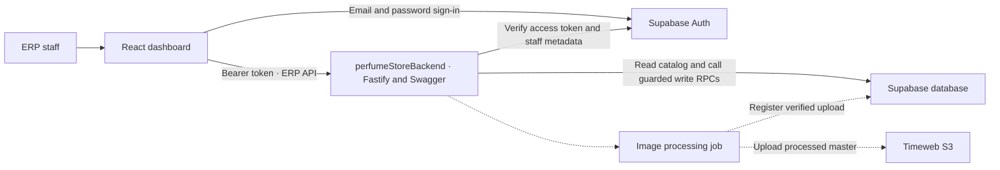

# PARFUMA ERP

React and Vite staff workspace for ERP operations. Dashboard business metrics are placeholders. Perfumes → Image library shows the initial snapshot of 375 perfumes, five registered master images, 370 missing master images, and 1.33% completion.

## Stage 2 checkpoint

All perfumes supports search, filters, sorting, pagination, catalog editing, reversible archive and restore, bulk archiving, and guarded deletion. The catalog defaults to Active and also offers Archived and All filters. The reported checkpoint snapshot contains 375 perfumes, with 365 active and 10 archived. The compact table switches to cards on narrow screens and uses green Active badges, grey Archived badges and red Delete buttons. Search applies after 350 ms and clearing immediately removes the URL query. Perfume details link General, Variants, SKUs, and registered Images. Marketplaces → SKU matching provides shop sync, manual corrections, and approved batch registration of internal mappings.

Existing SKU identities and permanent SKU deletion remain locked. Raspiv status changes and competing eligible Raspiv mappings are blocked. Registered images block perfume deletion. The central library shows the pilot snapshot. Stage 3 image generation must exclude archived perfumes from its default queue.

The combined Stage 2 database installation was reported successful. Reconcile the migration ledger against the five original migrations before running migration automation. Use a disposable database for write validation. Production ERP write enablement remains blocked on legacy authorization and deployed permission checks. Migration order and release gates are documented in `perfumeStoreBackend/docs/erp-stage-2-checkpoint.md`.

## Local development

Use Node.js 22.12+ or 24 LTS.

```sh
npm ci
npm run dev
```

When Supabase is unconfigured, **Open dashboard preview** opens the static overview in Vite development mode. Preview has no ERP API access. Production builds require a staff session verified by the ERP backend.

## Backend connection

Set `VITE_ERP_API_BASE_URL=http://127.0.0.1:3000` in `.env.local`. For ERP-only local testing, start Fastify from the `perfumeStoreBackend` project with `WEBSITE_OZON_DELIVERY_AUTO_CREATE_ENABLED=false npm start`. Restart Vite after editing the environment. Loopback HTTP is allowed in Vite development mode. For a production build, set `VITE_ERP_API_BASE_URL` to the trusted HTTPS origin of the backend before building.

The ERP sends the current Supabase access token to `GET /erp/me`. Fastify looks up the user through Supabase Auth and checks the server-managed staff flag before returning the account ID, email and staff status. Swagger UI is available on the backend at `/documentation`. The operation documents bearer authentication and responses for invalid credentials (401), missing staff access (403) and Auth unavailability (503).

## Staff sign-in

Use the same Supabase project as `perfumeStoreBackend`. In that project, open **Connect** for the Project URL and **Settings → API Keys → Publishable and secret API keys** for the publishable key. In `.env.local`, set `VITE_SUPABASE_URL` to the Project URL and `VITE_SUPABASE_PUBLISHABLE_KEY` to the browser-safe `sb_publishable_` key. Vite exposes `VITE_*` values to the browser, so keep privileged keys out of frontend environment files. Restart Vite after editing `.env.local`. [Supabase API key documentation](https://supabase.com/docs/guides/getting-started/api-keys)

### Provision the first staff account

1. In the same Supabase project, open **Authentication → Users**. Use your existing email/password account, or choose **Add user → Create new user** and enter your email and password there. Ensure the account email is confirmed and copy its user UUID.
2. From the ERP repository root, run the following once in a trusted terminal. Set `ERP_STAFF_USER_ID` to that UUID. This example reads the existing backend environment locally to reuse its server-side credentials. It reads the account before updating its server-managed `app_metadata` and preserves the other keys. [Supabase user management](https://supabase.com/docs/guides/auth/users) · [Auth Admin updateUserById](https://supabase.com/docs/reference/javascript/auth-admin-updateuserbyid)

```sh
ERP_STAFF_USER_ID='PASTE_USER_UUID' node --env-file=../perfumeStoreBackend/.env --input-type=module <<'JS'
import { createClient } from '@supabase/supabase-js'

const { ERP_STAFF_USER_ID: userId, SUPABASE_URL: url, SUPABASE_SECRET_KEY: key } = process.env
if (!url || !key || !/^[\da-f]{8}(?:-[\da-f]{4}){3}-[\da-f]{12}$/i.test(userId ?? '')) {
  throw new Error('Set a valid user UUID and verify the backend environment is available.')
}

const { auth } = createClient(url, key, {
  auth: { persistSession: false, autoRefreshToken: false },
})
const { data, error: lookupError } = await auth.admin.getUserById(userId)
if (lookupError || !data?.user) throw new Error('Could not find the user in the backend project.')

const { data: updated, error: updateError } = await auth.admin.updateUserById(userId, {
  app_metadata: { ...data.user.app_metadata, erp_staff: true },
})
if (updateError || updated?.user?.app_metadata?.erp_staff !== true) {
  throw new Error('Could not verify the staff grant.')
}
console.log('ERP staff access granted.')
JS
```

3. Open the ERP sign-in page after starting `npm run dev`. Sign in with the account you provisioned and refresh to verify the session restores. After signing out, open `/#settings` to confirm the sign-in screen appears, and submit an incorrect password to confirm rejection. Test staff denial with a separate account that lacks `erp_staff`.

## Architecture



Solid paths exist in this foundation. Dotted paths are planned. Fastify applies staff authorization to the ERP module and React uses the result to control view access. Keep database service credentials and S3 credentials in the backend environment.

Swagger documents the staff-gated `/erp` operations at `/documentation`. Stage 3 will build on the registered master image model and the existing Timeweb pilot.

```sh
npm run build
npm run preview
```
